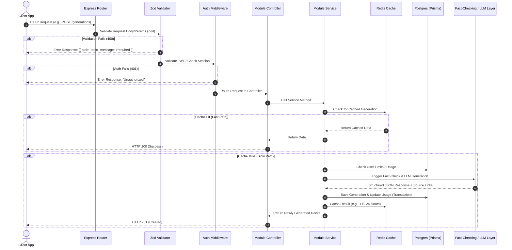
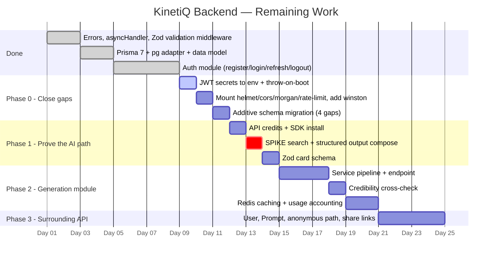

# KinetiQ: Production-Grade Backend Architecture & Implementation Plan

Welcome to the KinetiQ Backend Architecture & Implementation Plan. This document provides a concrete, step-by-step roadmap to build a highly scalable, secure, and performant Node.js backend using **TypeScript**, **Express**, and **Prisma (PostgreSQL)**. 

To separate KinetiQ from a typical "AI Wrapper" and make it a showcase of premium software engineering, this backend is structured as a **Modular Monolith**. It implements robust security, strict runtime data validation, global error management, caching, and a multi-layered intelligence engine that cross-references AI outputs with live web data.

> **Where this document sits:** this is the backend build guide with code templates.
> For product definition and scope, see [kinetiq-context.md](./kinetiq-context.md).
> For system architecture, data model, the AI pipeline, deployment, and current build status,
> see [architecture.md](./architecture.md) — that document is authoritative where the two
> overlap.

---

## 🏗️ 1. Architecture Overview & Request Lifecycle

A modular monolith divides the application into isolated, domain-specific modules (e.g., `auth`, `user`, `prompt`, `generation`, `analytics`). Each module contains its own routes, controller, service, schemas, and optional data-access layers, communicating with other modules via clean TypeScript interfaces.

### 🔄 The Request Lifecycle


---

## 🛠️ Phase 1: Core Foundations & Infrastructure

Before writing any business logic, we must establish a bulletproof base. This prevents the code from becoming cluttered with repetitive `try-catch` blocks and manual type checks.

### 📁 Step 1: Install Key Dependencies

**Already installed** (see `server/package.json`): `zod` (v4), `bcrypt`, `jsonwebtoken`,
`express-rate-limit`, `cors`, `helmet`, `winston`, `morgan`, `prisma`/`@prisma/client` (v7),
`@prisma/adapter-pg`, `pg`, `dotenv`.

> ⚠️ Several of these are installed but **not yet mounted** in `src/index.ts` — `helmet`,
> `cors`, `morgan`, and `express-rate-limit` are all dead weight until they are wired into
> the middleware chain, and `winston` is not configured at all. That is Phase 0 work.

**Still needed**, when you reach the AI and caching phases:
```bash
npm install @anthropic-ai/sdk ioredis
```

### 🧱 Step 2: Custom Error Framework
Create a global error-handling structure so your controllers don't need manual try-catch wrappers.

Create [server/src/utils/errors.ts](file:///home/joelanto/Projects/kinetiq/server/src/utils/errors.ts):
```typescript
export class HttpException extends Error {
  constructor(public statusCode: number, message: string, public details?: any) {
    super(message);
    Object.setPrototypeOf(this, new.target.prototype);
  }
}

export class BadRequestException extends HttpException {
  constructor(message = "Bad Request", details?: any) {
    super(400, message, details);
  }
}

export class UnauthorizedException extends HttpException {
  constructor(message = "Unauthorized") {
    super(401, message);
  }
}

export class ForbiddenException extends HttpException {
  constructor(message = "Forbidden") {
    super(403, message);
  }
}

export class NotFoundException extends HttpException {
  constructor(message = "Resource Not Found") {
    super(404, message);
  }
}

export class ConflictException extends HttpException {
  constructor(message = "Conflict", details?: any) {
    super(409, message, details);
  }
}

export class InternalServerErrorException extends HttpException {
  constructor(message = "Internal Server Error") {
    super(500, message);
  }
}
```

Create [server/src/utils/asyncHandler.ts](file:///home/joelanto/Projects/kinetiq/server/src/utils/asyncHandler.ts):
```typescript
import { Request, Response, NextFunction } from "express";

/**
 * Wraps async Express handlers to automatically forward thrown errors to the global error middleware.
 */
export const asyncHandler = (fn: Function) => {
  return (req: Request, res: Response, next: NextFunction) => {
    Promise.resolve(fn(req, res, next)).catch(next);
  };
};
```

Create [server/src/middleware/errorHandler.ts](file:///home/joelanto/Projects/kinetiq/server/src/middleware/errorHandler.ts):
```typescript
import { Request, Response, NextFunction } from "express";
import { HttpException } from "../utils/errors";

export const errorHandler = (
  err: Error,
  req: Request,
  res: Response,
  next: NextFunction
): void => {
  const statusCode = err instanceof HttpException ? err.statusCode : 500;
  const message = err.message || "Internal Server Error";
  const details = err instanceof HttpException ? err.details : undefined;

  // Real production backend: Log detailed errors internally, but don't expose stack traces to client
  console.error(`[Error] ${req.method} ${req.url} - Status: ${statusCode} - Msg: ${message}`);
  if (statusCode === 500) {
    console.error(err.stack);
  }

  res.status(statusCode).json({
    status: "error",
    statusCode,
    message: statusCode === 500 && process.env.NODE_ENV === "production" ? "Internal Server Error" : message,
    ...(details && { errors: details }),
    ...(process.env.NODE_ENV !== "production" && { stack: err.stack }),
  });
};
```

### 🛡️ Step 3: Zod Schema Validation Middleware
This middleware validates incoming requests against Zod schemas (for `body`, `query`, or `params`) and returns structured JSON errors before hitting route controllers.

✅ **This is already implemented** at
[server/src/middleware/validate.ts](file:///home/joelanto/Projects/kinetiq/server/src/middleware/validate.ts).
The shipped version is reproduced here because new modules will copy its usage pattern:

```typescript
import { Request, Response, NextFunction } from "express";
import { ZodSchema, ZodError } from "zod";
import { BadRequestException } from "../utils/errors";

export const validateRequest = <T>(schema: ZodSchema<T>) => {
  return async (req: Request, res: Response, next: NextFunction): Promise<void> => {
    try {
      const parsed = await schema.parseAsync({
        body: req.body,
        query: req.query,
        params: req.params,
      });

      const safeParsed = parsed as any;

      req.body = safeParsed.body;
      req.params = safeParsed.params;

      if (safeParsed.query) {
        for (const key in req.query) {
          delete req.query[key];
        }
        Object.assign(req.query, safeParsed.query);
      }

      next();
    } catch (error) {
      if (error instanceof ZodError) {
        const formattedErrors = error.issues.map((err) => ({
          field: err.path.slice(1).join("."),
          message: err.message,
        }));
        next(new BadRequestException("Validation failed", formattedErrors));
      } else {
        next(error);
      }
    }
  };
};
```

Three things in there are deliberate and worth not "simplifying" later:

| Detail | Why |
| --- | --- |
| `ZodSchema<T>`, not `AnyZodObject` | `AnyZodObject` was removed in Zod 4. The generic also carries the parsed shape through to the caller. |
| `error.issues`, not `error.errors` | Zod 4 renamed the field. `error.errors` is `undefined` here and would throw inside the error handler. |
| `req.query` mutated in place | Express 5 defines `req.query` as a getter — assigning to it throws. Delete the keys, then `Object.assign`. |

`err.path.slice(1)` drops the `body`/`query`/`params` prefix so the client sees `"email"`
rather than `"body.email"`.

---

## 🔐 Phase 2: Production-Grade Authentication & Sessions

Instead of standard JWTs that expire in 7 days (unsafe) or basic cookies, real production web apps utilize **short-lived access tokens (JWTs)** combined with **database-backed refresh tokens** with automatic rotation.

### 📝 Step 1: JWT & Session Mechanics
1. **Access Token (Short-lived)**: Valid for `15m`. Transmitted via `Authorization: Bearer <token>` header or Secure HTTP-only Cookie.
2. **Refresh Token (Long-lived)**: Valid for `7d`. Stored in the `Session` table in PostgreSQL. When a user requests a new Access Token:
   - Verify the refresh token signature.
   - Look up the `refreshToken` in the database.
   - If found and not expired: Generate a brand-new access token + rotate the refresh token (delete the old session, create a new session, and issue it).
   - If a refresh token is reused, it triggers "token reuse detection"—meaning we delete all sessions for that user, forcing them to re-log in (protects against theft).

Create Auth Middleware [server/src/middleware/auth.ts](file:///home/joelanto/Projects/kinetiq/server/src/middleware/auth.ts):
```typescript
import { Request, Response, NextFunction } from "express";
import jwt from "jsonwebtoken";
import { UnauthorizedException } from "../utils/errors";

export interface AuthRequest extends Request {
  user?: {
    id: string;
    email: string;
    role: string;
  };
}

export const requireAuth = (req: AuthRequest, res: Response, next: NextFunction) => {
  const authHeader = req.headers.authorization;
  if (!authHeader || !authHeader.startsWith("Bearer ")) {
    throw new UnauthorizedException("Authentication token is missing or invalid");
  }

  const token = authHeader.split(" ")[1];
  try {
    const payload = jwt.verify(token, process.env.JWT_ACCESS_SECRET || "access_secret") as {
      sub: string;
      email: string;
      role: string;
    };

    req.user = {
      id: payload.sub,
      email: payload.email,
      role: payload.role,
    };
    next();
  } catch (error) {
    throw new UnauthorizedException("Token expired or corrupted");
  }
};
```

> **Import note:** the Prisma *client* singleton is `src/prisma.ts` (it builds a `pg` `Pool`
> and wraps it in `PrismaPg`). `src/prisma.config.ts` is the Prisma 7 **CLI** config and
> exports a `defineConfig` object, not a client — importing it expecting a client is a silent
> runtime failure. Always `import prisma from "../prisma"` (adjusting depth per module).
> `requireAuth` needs no database access at all: verifying the access-token signature is the
> whole job, and hitting Postgres on every authenticated request would defeat the purpose of
> short-lived stateless access tokens.

> ⚠️ **Secrets.** `JWT_ACCESS_SECRET` and `JWT_REFRESH_SECRET` are read by both this
> middleware and `auth.service.ts`, but neither is present in `server/.env` — so every token
> issued today is signed with the hardcoded fallback literals `"access_secret"` /
> `"refresh_secret"`. Add both to `.env` and make the service **throw on boot** when either is
> missing. A fallback secret is worse than a crash: it fails silently and produces forgeable
> tokens.

---

## 🧱 Phase 3: The Modular Business Architecture (User & Auth Module)

Let's look at how a modular structure keeps directories clean. For each module (e.g. `user`), we organize files directly by context. Let's see the skeleton of the **Auth & User Modules**.

```
server/src/modules/
├── auth/
│   ├── auth.controller.ts     # Handles login, register, refresh tokens, logout routes
│   ├── auth.routes.ts         # Routes binding to validator & controller
│   ├── auth.schema.ts         # Zod schemas for input validation
│   └── auth.service.ts        # Performs password comparisons, signs JWTs, creates sessions
└── user/
    ├── user.controller.ts     # Handles profile views, configurations
    ├── user.routes.ts         # User routes
    ├── user.schema.ts         # User Zod validations
    └── user.service.ts        # Fetches/mutates users via Prisma
```

### 🧬 Sample implementation for the Auth Module
Let's see exactly how this ties together by looking at the schema validation and controller implementation:

Create [server/src/modules/auth/auth.schema.ts](file:///home/joelanto/Projects/kinetiq/server/src/modules/auth/auth.schema.ts):
```typescript
import { z } from "zod";

export const registerSchema = z.object({
  body: z.object({
    email: z.email("Invalid email address format"),
    username: z
      .string()
      .min(3, "Username must be at least 3 characters")
      .max(30, "Username cannot exceed 30 characters")
      .regex(/^[a-zA-Z0-9_]+$/, "Username can only contain alphanumeric characters and underscores"),
    password: z.string().min(8, "Password must be at least 8 characters long"),
  }),
});

export const loginSchema = z.object({
  body: z.object({
    email: z.email("Invalid email address format"),
    password: z.string().min(1, "Password is required"),
  }),
});
```

> **Zod 4:** email validation is the top-level `z.email()`, not `z.string().email()` — the
> chained `.email()` method is deprecated in v4. This file is already implemented and matches
> the above.

Create [server/src/modules/auth/auth.routes.ts](file:///home/joelanto/Projects/kinetiq/server/src/modules/auth/auth.routes.ts):
```typescript
import { Router } from "express";
import { AuthController } from "./auth.controller";
import { validateRequest } from "../../middleware/validate";
import { registerSchema, loginSchema } from "./auth.schema";

const router = Router();
const controller = new AuthController();

router.post("/register", validateRequest(registerSchema), controller.register);
router.post("/login", validateRequest(loginSchema), controller.login);
router.post("/refresh", controller.refresh);
router.post("/logout", controller.logout);

export default router;
```

---

## 🤖 Phase 4: Setting Up the AI & Fact Verification Engine (Anti-Wrapper Design)

A primary flaw of basic AI apps is their tendency to hallucinate and return stale information (e.g., details about a player transfer that occurred yesterday). KinetiQ separates itself from cheap wrappers by grounding every generation in live web results and then **verifying the grounding in our own code** rather than trusting the model's self-report.

### 🔑 Decision: one vendor, not two

Earlier drafts of this plan routed grounding through a separate search API (Tavily / Serper /
Google CSE). **That is no longer the design.** The Claude Messages API exposes a server-side
web search tool: it is declared in the request's `tools` array, runs on Anthropic's
infrastructure, and returns results — with their URLs — as content blocks in the *same*
response.

| With a separate search vendor | With built-in web search |
| --- | --- |
| Two API keys, two SDKs, two rate limits, two failure modes | One |
| Search call → format context → generation call | One request |
| Hand-rolled snippet-to-context assembly | Handled server-side |
| Citation URLs stitched together by hand | Returned alongside the results |

```
                  ┌──────────────────────┐
                  │ User Topic+Freshness │
                  └──────────┬───────────┘
                             │
                             ▼
               ┌───────────────────────────┐
               │ Normalize + hash → Redis  │──── HIT ──→ return < 200ms
               └─────────────┬─────────────┘
                             │ MISS
                             ▼
              ┌─────────────────────────────┐
              │ ONE Claude request:         │
              │  · web_search tool declared │
              │  · card schema as structured│
              │    output format            │
              │  · expansion instructions   │
              │    in the system prompt     │
              └─────────────┬───────────────┘
                            │
                            ▼
              ┌─────────────────────────────┐
              │ Credibility cross-check     │
              │ (OUR code, not the model):  │
              │  collect URLs search really │
              │  returned → downgrade any   │
              │  unmatched 🟢 to 🟡         │
              └─────────────┬───────────────┘
                            │
                            ▼
             ┌───────────────────────────────┐
             │ Zod-validate · persist · cache│
             └──────────────┬────────────────┘
                            │
                            ▼
               ┌──────────────────────────┐
               │ Return Swipeable Cards:  │
               │ - Short facts            │
               │ - Trust badge (🟢/🟡)    │
               │ - Direct source links    │
               └──────────────────────────┘
```

### 🧠 Step 1: Smart Prompt Expansion (in the system prompt)

Expansion does not need its own API round-trip. Instruct the model, in the cached system
prompt, to widen the topic before searching — if a user types *"Premier League"*, it should
search across standings, recent transfers, injuries, and records rather than the bare phrase.
Folding this into the same call keeps it on the cached prefix, so it costs nothing extra per
generation.

Freshness shapes how hard it searches: `LATEST` leans on search, `HISTORICAL` barely needs
it, `MIXED` balances the two.

### 🔍 Step 2: The Fact Credibility Layer

This is the differentiator, so the mechanism matters more than anywhere else in the codebase.

1. **Constrain the output.** Set the card array as the response format via
   `output_config: { format: … }`. Note this is **not** the deprecated `output_format`
   parameter. The model must return schema-valid JSON — no parsing prose, no regex.
2. **Ask for citations.** Instruct it to mark each card `VERIFIED_SOURCE` with a `sourceUrl`
   when the claim is grounded in a search result, `AI_INFERRED` otherwise.
3. **Then verify it yourself.** Walk the response's `web_search_tool_result` blocks, collect
   the set of URLs search *actually* returned, and downgrade any card claiming
   `VERIFIED_SOURCE` whose `sourceUrl` is not in that set.

Step 3 is the one that matters. Trusting the model to self-report its own grounding is
exactly the hallucination problem the product claims to solve — a model that invents a fact
can equally invent a plausible-looking URL for it. Verification has to be a property of our
code checking observed evidence.

#### Three traps to code around

| Trap | Consequence | Handling |
| --- | --- | --- |
| Declaring `code_execution` alongside `web_search` | The search tool already runs code execution internally for result filtering; a second execution environment confuses the model | Declare only the web search tool |
| Search failures return **HTTP 200** | A failed search yields a `web_search_tool_result` whose `content` is an *object* (`{ error_code: … }`) instead of the usual *array* — indexing it throws on an otherwise valid response | Branch on the shape before iterating |
| Structured output + server-side search may not compose | Document-block citations are documented as incompatible with `output_config.format`; whether the search tool shares that restriction is unconfirmed | **Spike this first** (Phase 1 below). Fallback: two calls — search-and-summarize, then a schema-constrained formatting pass. One extra call, no other design change. |

#### Request settings for `claude-opus-5-5`

| Concern | Setting |
| --- | --- |
| Thinking | `{ type: "adaptive" }`, or omit. `disabled` and `budget_tokens` both return **400** on this model. |
| Effort | `output_config: { effort: "medium" }` — set it explicitly; this model defaults to `medium`, not `high` |
| Tool choice | Leave `auto`. Forced `tool_choice` (`any` / `tool`) returns **400** on this model. |
| `max_tokens` | ~16000. Don't lowball — a truncated deck wastes a paid call. |
| Refusals | Check `stop_reason === "refusal"` **before** reading `content`; enable server-side fallbacks |
| Cost control | Set `max_uses` on the search tool, and keep the system prompt + schema byte-stable so prompt caching holds |

> **Access prerequisite:** this requires prepaid credits at `console.anthropic.com`. A Claude
> Pro subscription covers claude.ai and Claude Code — it issues no API key and cannot serve
> application traffic.

Here is an architectural template for [server/src/modules/generation/generation.service.ts](file:///home/joelanto/Projects/kinetiq/server/src/modules/generation/generation.service.ts):

```typescript
import prisma from "../../prisma";
import { BadRequestException } from "../../utils/errors";
import { cardArraySchema, type Card } from "./generation.schema";

const MODEL = "claude-opus-5-5";

const TTL_SECONDS = {
  LATEST: 4 * 60 * 60,
  MIXED: 12 * 60 * 60,
  HISTORICAL: 30 * 24 * 60 * 60,
} as const;

type Freshness = keyof typeof TTL_SECONDS;

export class GenerationService {
  async generateDeck(userId: string, topic: string, options: { freshness: Freshness }) {
    // 1. Cache first — a hit costs nothing, so it must not consume quota.
    const key = this.cacheKey(topic, options.freshness);
    const cached = await redis.get(key);
    if (cached) return JSON.parse(cached);

    // 2. Limits, against the rolling period window (see architecture.md §4).
    await this.assertWithinLimit(userId);

    // 3. One Claude request: web search tool + card schema as structured output.
    const { cards, searchUrls, tokensUsed } = await this.generateGroundedCards(
      topic,
      options.freshness
    );

    // 4. Verify grounding in OUR code, then validate the shape.
    const verified = cardArraySchema.parse(this.downgradeUnverified(cards, searchUrls));

    // 5. Persist atomically.
    const generation = await prisma.$transaction(async (tx) => {
      const prompt = await tx.prompt.create({
        data: { userId, content: topic, title: topic.slice(0, 60) },
      });

      const created = await tx.generation.create({
        data: {
          promptId: prompt.id,
          userId,
          modelUsed: MODEL,
          response: verified as any, // Json column
          tokensUsed,
        },
      });

      await tx.usage.update({
        where: { userId },
        data: {
          totalPrompts: { increment: 1 },
          periodPrompts: { increment: 1 },
          totalTokens: { increment: tokensUsed },
          lastActiveAt: new Date(),
        },
      });

      return created;
    });

    // 6. Cache with a freshness-aware TTL.
    await redis.set(key, JSON.stringify(generation), "EX", TTL_SECONDS[options.freshness]);

    return generation;
  }

  /**
   * The credibility layer. A model that invents a fact can invent a URL for it,
   * so a VERIFIED_SOURCE badge is only honoured when the cited URL appears in
   * the set search actually returned.
   */
  private downgradeUnverified(cards: Card[], searchUrls: Set<string>): Card[] {
    return cards.map((card) =>
      card.credibility === "VERIFIED_SOURCE" &&
      (!card.sourceUrl || !searchUrls.has(card.sourceUrl))
        ? { ...card, credibility: "AI_INFERRED" as const, sourceUrl: undefined }
        : card
    );
  }

  private cacheKey(topic: string, freshness: Freshness) {
    const normalized = topic.trim().toLowerCase().replace(/\s+/g, " ");
    const hash = createHash("sha256").update(normalized).digest("hex");
    return `kinetiq:deck:${hash}:${freshness}`;
  }

  /**
   * Single Messages request declaring the web_search tool with the card array
   * as structured output. Returns the cards, the URL set search actually
   * returned (for downgradeUnverified), and token usage.
   *
   * Implementation notes before writing this:
   *  - Do NOT also declare code_execution; web search runs it internally.
   *  - A search error returns HTTP 200 with `content` as an OBJECT, not an
   *    array — branch on the shape before iterating.
   *  - Check `stop_reason === "refusal"` before reading `content`.
   *  - Verify structured output composes with the search tool (Phase 1 spike);
   *    if not, split into two calls.
   */
  private async generateGroundedCards(topic: string, freshness: Freshness) {
    throw new Error("Not implemented — see Phase 1 of the execution plan");
  }

  private async assertWithinLimit(userId: string) {
    const usage = await prisma.usage.findUnique({ where: { userId } });
    if (usage && usage.periodPrompts >= 10) {
      throw new BadRequestException("Daily generation limit reached");
    }
  }
}
```

> **Two corrections from the earlier draft of this template.** The Prisma client is imported
> from `../../prisma` (the singleton), never `../../prisma.config` (the CLI config). And the
> limit check reads `periodPrompts`, not `totalPrompts` — the latter is a lifetime counter
> that can never reset, so a "daily limit" built on it permanently locks the user out after
> the first 10 decks. Both the period column and the reset logic are additive schema work
> listed in [architecture.md](./architecture.md) §4.

---

## ⚡ Phase 5: High-Performance Caching (Redis)

Because LLM generation takes **1.5s to 4s** and incurs API token costs, caching is critical.
If two users request decks on *"Artificial Intelligence"* or *"F1 2026"* within the same hour, they shouldn't trigger two LLM generations. Instead, pull from a Redis cache in **< 50ms**.

### ⚙️ Redis Cache Logic:
1. **Cache Key Structure**: `kinetiq:cache:deck:<hash-of-prompt>:<freshness>`
2. **TTL (Time to Live)**: 
   - `LATEST`: `4 Hours` (since news changes daily)
   - `HISTORICAL`: `30 Days` (rarely changes)
   - `MIXED`: `12 Hours`

---

## 🚀 Execution Checklist: How to Start Coding

Here is the exact order to write and test your backend code to build a secure, highly cohesive app.



> The spike (`a2`) is marked critical deliberately: it is the only task whose outcome can
> change the design of anything downstream. Do it before writing the generation module, not
> after.

### 🗺️ Step-by-Step Execution Plan

1. ~~**Step 1: Core setup**~~ ✅ **Done.** `HttpException` + subclasses, `asyncHandler`, Zod
   validation middleware, and the global `errorHandler` all exist and are registered in
   [server/src/index.ts](file:///home/joelanto/Projects/kinetiq/server/src/index.ts).
2. ~~**Step 2: Database Initialization**~~ ✅ **Done.** Prisma 7 with the `pg` driver adapter,
   `DATABASE_URL` configured, all seven models defined.
3. 🟡 **Step 3: Auth & User Operations** — *auth complete, user module not started.*
   - ✅ `/auth/register`, `/auth/login`, `/auth/refresh` (with rotation + reuse detection),
     `/auth/logout`
   - ⬜ Add `JWT_ACCESS_SECRET` / `JWT_REFRESH_SECRET` to `.env` and throw on boot if absent
     — **highest-priority item in the repo**
   - ⬜ Build the User module and apply `requireAuth` to `GET /api/users/me`. The guard is
     written but not yet attached to a single route, so it has never actually run.
4. ⬜ **Step 4: AI grounding integration**
   - Add prepaid credits at `console.anthropic.com` and install `@anthropic-ai/sdk`.
   - **Spike first:** one throwaway script, hardcoded topic, that declares the `web_search`
     tool *and* sets the card array as structured output in a single request. Confirm the two
     compose before any module depends on it. If they don't, fall back to two calls.
   - Write `generation.schema.ts` — the Zod card schema, reused for both the LLM response
     format and inbound validation.
5. ⬜ **Step 5: Card & Deck Generation**
   - Build the Generation module following the §Phase 4 pipeline: cache → limits → single
     grounded call → credibility cross-check → transaction → cache write.
   - Expose `POST /api/generations` behind `requireAuth`, then add the anonymous IP-limited
     path.
   - Add Redis last. Get it correct without the cache, then make it fast — a cache in front
     of a wrong answer just serves the wrong answer for 30 days.

---

> [!TIP]
> **Live grounding needs no search vendor.** The web search tool is part of the Messages API
> and runs server-side, returning citation URLs with the results — so there is no Tavily or
> Serper account to set up, no second key to rotate, and no snippet-formatting code to own.
> Bound the cost with `max_uses` on the tool definition.

> [!IMPORTANT]
> **Prompt caching is the main cost lever after Redis.** The system prompt plus card schema
> is a large, byte-identical prefix on every generation. Render order is
> `tools` → `system` → `messages`, and any byte change invalidates everything after it — so
> keep tool definitions and the system prompt frozen and first, and put the user's topic and
> freshness last. No timestamps, no request IDs, no unsorted JSON in the prefix; those are
> silent cache killers. Assert `usage.cache_read_input_tokens > 0` across repeated requests to
> confirm it is actually working.

> [!IMPORTANT]
> Keep your Prisma schema aligned. Notice that the `output` in generator `client` is set to `../src/generated/prisma`. Ensure that you build the Prisma client (`npx prisma generate`) before running the server so the typescript imports resolve correctly.

> [!WARNING]
> **Before deploying anything:** `JWT_ACCESS_SECRET` and `JWT_REFRESH_SECRET` are read by
> `auth.service.ts` and `middleware/auth.ts` but are absent from `server/.env`, so both fall
> back to the hardcoded literals `"access_secret"` and `"refresh_secret"`. Every token the API
> issues right now is signed with a publicly-known key and is trivially forgeable. Set both,
> and replace the `||` fallbacks with a boot-time check that throws.
